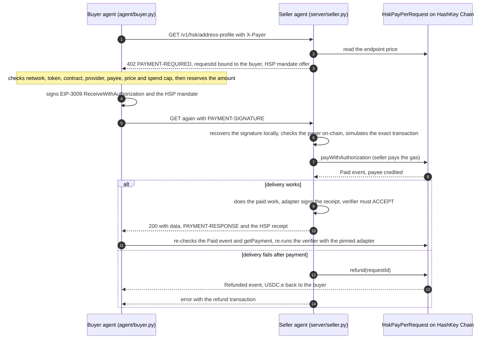

# HSK Meter

**One agent pays another for every API request, in USDC.e on HashKey Chain, settled on-chain per request.**
If the seller cannot deliver after it has been paid, the payment is refunded on-chain automatically, and on the
default x402 path the buyer needs no gas token. With an HSP-style mandate attached, the seller ships the data only after a verifier has
checked the adapter-signed receipt against the buyer's signed mandate.

By Swift Bot Labs, for the HashKey Chain Horizon Hackathon (India), track **Agent Payments & A2A Settlement**.

**Live dashboard:** [swiftbotlab.github.io/hsk-meter](https://swiftbotlab.github.io/hsk-meter/) reads the contract's
events straight from the public explorer in your browser: totals, USDC.e per day, refund rate and the latest payments,
each linked to its transaction.

| | |
|---|---|
| Network | HashKey Chain mainnet, chain id `177` |
| Settlement contract | [`HskPayPerRequest` `0x78C8476772BC209C3df09Da5e129d0879cd57F8c`](https://hsk.blockscout.com/address/0x78C8476772BC209C3df09Da5e129d0879cd57F8c?tab=contract), source verified on Blockscout and [Sourcify](https://repo.sourcify.dev/177/0x78C8476772BC209C3df09Da5e129d0879cd57F8c) (exact match) |
| Settlement token | USDC.e [`0x054ed45810DbBAb8B27668922D110669c9D88D0a`](https://hsk.blockscout.com/token/0x054ed45810DbBAb8B27668922D110669c9D88D0a) (Circle `FiatTokenV2_2`, EIP-3009) |
| Payment protocol | x402 v2 (`402 Payment Required`, `PAYMENT-SIGNATURE`, `PAYMENT-RESPONSE`), network `eip155:177` |
| Seller | provider [`0x30CCc6d816854d1a66fBfecE15b1515a3E941160`](https://hsk.blockscout.com/address/0x30CCc6d816854d1a66fBfecE15b1515a3E941160), endpoints `1` and `2` |

## Live proof on mainnet

Every row is a real request made over HTTP through the seller in this repository, paid by the buyer client in
this repository. Rows 1-5 ran v0.1 at the launch prices; rows 6-23 ran the hardened v0.2 inside its sandbox, and row
23 was paid by an MCP client through `agent/mcp_server.py`. The [dashboard](https://swiftbotlab.github.io/hsk-meter/)
recomputes the totals from the chain.

| # | Request | Payment path | Transaction |
|---|---|---|---|
| 1 | address profile, 0.01 USDC.e | x402 `exact` + HSP-style mandate, buyer paid no gas, verifier ACCEPT | [`0x98526a6b…`](https://hsk.blockscout.com/tx/0x98526a6b276b3763cde68297c29f89f194a5fed99a0add55794f57ece123da79) |
| 2 | tx check (of #1), 0.005 | x402 `exact` | [`0x672b4957…`](https://hsk.blockscout.com/tx/0x672b495773c17c6216ec24d7981091d2209d43e545e17b463a7c9744d830dfc5) |
| 3 | tx check of a hash that does not exist, 0.005 | x402 `exact`, then automatic **refund** | paid [`0x63d7f42d…`](https://hsk.blockscout.com/tx/0x63d7f42d638b79fb1a16404ca025a1524c6c635f601c6f99d8c0df611f4a0f52), refunded [`0xaa744ebd…`](https://hsk.blockscout.com/tx/0xaa744ebdacf908b511dd5e23cc592cd49c55e9f466012a0b26e3388e909c40fc) |
| 4 | address profile, 0.01 | buyer calls `pay()` itself and proves it | [`0xfb36cf54…`](https://hsk.blockscout.com/tx/0xfb36cf54ef11efccca707b465ac9ff95dda1f075eab59136485369ce76783856) |
| 5 | tx check, 0.005 | x402 `exact`; the same header replayed: served 3 times, settled once, then refused | [`0x04ddbc59…`](https://hsk.blockscout.com/tx/0x04ddbc5973a69cd5620f3eb516b6ddbc6be2be4630efeda507fa3ca0c181917e) |
| 6 | address profile, 0.03 | x402 `exact` + HSP-style mandate, verifier ACCEPT, adapter pinned | [`0x5bf9515b…`](https://hsk.blockscout.com/tx/0x5bf9515b09692b156cfbe080b451ab0a8a74e2a2e41e2bb8d93aecc0f770a7c9) |
| 7 | tx check, 0.025 | x402 `exact` | [`0x3a88578a…`](https://hsk.blockscout.com/tx/0x3a88578a594d3e16d493c68fd168e20e0a750d92ce16bd7f216721877f7147ca) |
| 8 | address profile, 0.03 | x402 `exact`; delivery failed (operator test switch), automatic **refund** | paid [`0x543e14fb…`](https://hsk.blockscout.com/tx/0x543e14fbf0aa9e15932405e70df912bca1d0b1da40be8b33ad1d4b88e557f9b5), refunded [`0xd6e4e725…`](https://hsk.blockscout.com/tx/0xd6e4e7257aa7a472566dc0a27712b58a23b556a9ddb39e93504f582707fdfb0c) |
| 9 | address profile (settlement contract), 0.03 | x402 `exact` + HSP-style mandate, verifier ACCEPT, adapter pinned | [`0x68113c45…`](https://hsk.blockscout.com/tx/0x68113c4551acc6264b4d13bbb57772056cc4e8fbff365b744213f45ec78b88d1) |
| 10 | tx check (the deployment), 0.025 | x402 `exact` | [`0x81bf3c5c…`](https://hsk.blockscout.com/tx/0x81bf3c5cd505309e733ab0bc243cacccd44401dfe070fbd612b85f9bd4bf4ba7) |
| 11 | address profile (USDC.e), 0.03 | x402 `exact` + HSP, verifier ACCEPT | [`0x88fe48d3…`](https://hsk.blockscout.com/tx/0x88fe48d3bc73b097f63e8025f6e8ea0262484f155609a293d1deb75855a76082) |
| 12 | address profile (settlement contract), 0.03 | x402 `exact` + HSP, verifier ACCEPT | [`0x2b5d7f4e…`](https://hsk.blockscout.com/tx/0x2b5d7f4e33e7ba676c9a8e2dd28d79ad2c3b2674f34b23cfefa38687f3902a05) |
| 13 | tx check (of #6), 0.025 | x402 `exact` + HSP, verifier ACCEPT | [`0xe1024acd…`](https://hsk.blockscout.com/tx/0xe1024acdbc23afb4b21b3aff37c197edae98efb9b1a998d160df8163de80eb3a) |
| 14 | address profile (WHSK), 0.03 | x402 `exact` | [`0xfc2b96a9…`](https://hsk.blockscout.com/tx/0xfc2b96a94da5b9fa1f35a9d05d52ad0a09161ee564dc32a0fe5c31f07636d72a) |
| 15 | tx check (a gas transfer), 0.025 | x402 `exact` | [`0xd6d0e74d…`](https://hsk.blockscout.com/tx/0xd6d0e74d10f844e389aff0622549f6acf1cbdaa0117e25d32ca5d4a4635ec111) |
| 16 | address profile, 0.03 | x402 `exact`; delivery failed (operator test switch), automatic **refund** | paid [`0xb29f7615…`](https://hsk.blockscout.com/tx/0xb29f76152830d5876784a1362fdd4a757bdf0b1f6cfcffca11d01108d00f0d60), refunded [`0xa2fe58d3…`](https://hsk.blockscout.com/tx/0xa2fe58d3002a3601bb81b8b3cf1178ef07061abbc69b9870131d76f2f5d7ae86) |
| 17 | tx check (of #1), 0.025 | x402 `exact` + HSP, verifier ACCEPT | [`0xca40a411…`](https://hsk.blockscout.com/tx/0xca40a4110135d85cc55ab6b16096ae3cce4b76e95e6ff7ab96e76fdc125faf62) |
| 18 | address profile (provider), 0.03 | buyer approves and calls `pay()` itself | approve [`0x2a9ab663…`](https://hsk.blockscout.com/tx/0x2a9ab6631e49cdfb214712882c18e9e0bc150914f03d85eb232e6edece7cd696), pay [`0xdec751cc…`](https://hsk.blockscout.com/tx/0xdec751cc9b3cf810cb4615b4d869e417d1174b0857d7de43064b056ba86e5036) |
| 19 | tx check (of #7), 0.025 | x402 `exact` | [`0x33cfa3fa…`](https://hsk.blockscout.com/tx/0x33cfa3fa4af5ec3f1b9b55da35829f9d276a276ae686c3f88580806532c420d3) |
| 20 | address profile (USDT), 0.03 | x402 `exact` + HSP, verifier ACCEPT | [`0xa9843546…`](https://hsk.blockscout.com/tx/0xa984354601db631fde9f7dabea9bcac2e2706a485f38a5b1ab993254df04e87f) |
| 21 | tx check (a gas transfer), 0.025 | x402 `exact` | [`0x3573a1e7…`](https://hsk.blockscout.com/tx/0x3573a1e743dc982b3f93094696f0afa58886a6ad4a5f20181dcd1bb6cb714745) |
| 22 | address profile (payee), 0.03 | x402 `exact` | [`0xfad63c27…`](https://hsk.blockscout.com/tx/0xfad63c27ba1cf8a89a2f2510340d7b8113bb64c890bf27e9dc403c1dee1d20d7) |
| 23 | tx check (of #22), 0.025 | paid through the MCP tool `hsk_meter_pay`: x402 `exact` + HSP, verifier ACCEPT | [`0x8eea4457…`](https://hsk.blockscout.com/tx/0x8eea4457da07928d2f0d3ba465da6770188c4e1f4f9dc4a848d3d081294ddc37) |

Setup transactions: deployment [`0xe08891e3…`](https://hsk.blockscout.com/tx/0xe08891e35a7197a62a5cb165a6e2dea194842f3dba00711fc65207cec120fe73),
endpoint registrations [`0xec7dd370…`](https://hsk.blockscout.com/tx/0xec7dd370d753d746a264e3bd13acdca1733b323132e5cbe5184a573ec56f27b4)
and [`0x97e3dd2d…`](https://hsk.blockscout.com/tx/0x97e3dd2d6b5cc86a0a81231f84deaf6ae706bbbcf6a2bf916c3750f170464a82),
price changes [`0x62188d0a…`](https://hsk.blockscout.com/tx/0x62188d0abc975d81fd2212ea2197dd2d990fd2be3a168a48b7ba995a58980ef4)
and [`0x86e73f35…`](https://hsk.blockscout.com/tx/0x86e73f35a5ebb00efc93b8cc449838b812ec601ccb336e904c99530832b6576c),
payee withdrawal [`0x159f8304…`](https://hsk.blockscout.com/tx/0x159f830494dd86272b9e2ba53d9801a5b4a3c190f38a5ef46a54ccf36e67bbe8).

Prices are set on-chain per endpoint: address profile **0.03 USDC.e**, transaction check **0.025 USDC.e**. Each
price covers at least twice the worst settlement gas measured (246,503 gas at 500 gwei = 0.123 HSK, about $0.011),
because the seller pays the gas of every `exact` settlement.

> [!NOTE]
> Anyone can register endpoints on the contract, so contract-wide totals are not this service's numbers. Count only
> endpoints `1` and `2` of provider `0x30CCc6d816854d1a66fBfecE15b1515a3E941160`.

## How a request is paid



The contract (`contracts/src/HskPayPerRequest.sol`, no admin, no upgrades, nothing payable):

- Providers register priced endpoints; a payee must consent to the provider that pays it.
- `payWithAuthorization` pulls exactly the price with USDC.e `receiveWithAuthorization`. The EIP-3009 nonce must equal
  `authorizationNonce(endpointId, requestId) = keccak256(abi.encode(contract, endpointId, requestId))`, so one signature
  pays one request on one endpoint and nothing else. Only the contract can execute a `ReceiveWithAuthorization`, so a
  copied signature cannot be front-run into a bare transfer.
- `pay(endpointId, requestId, amount)` is the same payment for buyers that approve and pay themselves.
- A `requestId` carries its payer in the top 20 bytes, so nobody else can pay (or burn) it, and it is paid at most once.
- Price changes apply to new payments only; a stale quote gets `WrongAmount`, never a different charge.
- The provider can refund a paid request once, out of the payee's unwithdrawn credit. Payees pull their credit with
  `withdraw`.

### x402 v2 profile

Standard parts: the `PAYMENT-REQUIRED` / `PAYMENT-SIGNATURE` / `PAYMENT-RESPONSE` headers (base64 JSON),
`x402Version: 2`, `accepts[]` with `scheme: "exact"`, `network: "eip155:177"`, `amount`, `asset`, `payTo`,
`maxTimeoutSeconds`, and a `PaymentPayload` of `{signature, authorization: {from, to, value, validAfter, validBefore, nonce}}`.

Specific to this rail (declared in `accepts[0].extra`): the signed type is `ReceiveWithAuthorization`
(`primaryType`, `settlement: "contract"`), `payTo` is the settlement contract, and the nonce comes from the quote
(`extra.nonce`) because it binds the payment to one request. A client that signs a random-nonce
`TransferWithAuthorization` is refused before anything is sent. `accepts[1]` (`hsk-paywall-tx`) is the self-paid
alternative.

## Quickstart

Requirements: Python 3 (tested with 3.14) and `pip install -r requirements.txt` (pinned `eth-account`, `eth-abi`,
`eth-utils`, `hexbytes`). Key files hold one `NAME=0x...` value each, mode `0600`, and are never committed.

### Buyer: pay for a request

The buyer needs USDC.e on HashKey Chain and no HSK (the seller pays the gas of `exact` settlements).

```sh
echo "HKPW_BUYER_PK=0x..." > buyer.env && chmod 600 buyer.env      # your buyer key, kept out of the repo

python3 agent/buyer.py "https://SELLER/v1/hsk/address-profile?address=0x78C8476772BC209C3df09Da5e129d0879cd57F8c" \
  --key-file buyer.env \
  --expect-provider 0x30CCc6d816854d1a66fBfecE15b1515a3E941160 \
  --expect-payee 0xA8A49A6Ca872D54a8FD5FB121139De9bff62a48D \
  --max-price 0.05 --session-cap 0.20 \
  --hsp --pin-adapter 0x4D281e0a98fD40Bb824F88D5e037bd8d03C4403a
```

The buyer refuses to sign unless the quote is for chain 177, USDC.e, this contract, the pinned provider and payee,
and the on-chain price, and unless the amount fits under `--max-price` and the session cap. It then verifies the
`Paid` (or `Refunded`) event and `getPayment` itself. `--scheme tx` pays with its own `pay()` transaction instead
(that needs a little HSK for gas).

### Seller: sell an API per request

1. Register your endpoints on the contract from a provider key, and let the payee consent once, for example with
   Foundry's `cast` and an encrypted keystore account:

   ```sh
   RPC=https://mainnet.hsk.xyz; METER=0x78C8476772BC209C3df09Da5e129d0879cd57F8c
   cast send $METER "approveProvider(address,bool)" $PROVIDER true --rpc-url $RPC --account payee
   cast send $METER "registerEndpoint(uint128,address,string)" 30000 $PAYEE "GET /v1/your/path" --rpc-url $RPC --account provider
   ```

   Prices are in USDC.e base units (6 decimals): `30000` = 0.03 USDC.e.
2. Map each paid path to its endpoint id in `RESOURCES` in `server/seller.py`.
3. Put three files in a key directory: `provider.env` (`HKPW_PROVIDER_PK`), `adapter.env` (`HKPW_ADAPTER_PK`, signs
   HSP receipts) and `token.env` (`PAYWALL_TOKEN_KEY`, 32 random bytes in hex). The payee key never goes on the server.
4. Run it in the bubblewrap sandbox (recommended) or directly:

   ```sh
   HSK_METER_KEY_DIR=/path/to/keys HSK_METER_VENV=/path/to/venv deploy/run_sandboxed.sh seller --port 8402
   python3 server/seller.py --key-dir /path/to/keys --port 8402      # without the sandbox
   ```

   Free routes: `GET /`, `GET /health`, `GET /.well-known/x402`. The payee withdraws earned credit with
   `withdraw(to, amount)` from its own wallet.

## Use it from any MCP client

`agent/mcp_server.py` runs the buyer as an MCP server over stdio (no extra dependencies), so any MCP-capable agent
can pay HSK Meter sellers per request. It offers three tools:

| Tool | What it does |
|---|---|
| `hsk_meter_quote` | fetches the seller's x402 terms for a URL and runs the spend guard on them; signs and pays nothing |
| `hsk_meter_pay` | pays one request (optionally with the HSP-style mandate) and returns the data plus the settlement transaction, or the refund |
| `hsk_meter_status` | session spend (spent, reserved, cap, remaining) and the buyer's USDC.e balance |

The operator sets the limits when starting the server; the client cannot change them. These are the key, the seller
origins it may pay, the pinned provider, payee and HSP adapter, the per-request price limit (a client may pass a lower
`max_price`, never a higher one), the session cap and payments per minute. Seller data is returned as untrusted content.

```json
{
  "mcpServers": {
    "hsk-meter": {
      "command": "python3",
      "args": ["/path/to/hsk-meter/agent/mcp_server.py",
               "--key-file", "/path/to/buyer.env",
               "--allow-origin", "https://SELLER",
               "--expect-provider", "0x30CCc6d816854d1a66fBfecE15b1515a3E941160",
               "--expect-payee", "0xA8A49A6Ca872D54a8FD5FB121139De9bff62a48D",
               "--pin-adapter", "0x4D281e0a98fD40Bb824F88D5e037bd8d03C4403a",
               "--max-price", "0.05", "--session-cap", "0.20"]
    }
  }
}
```

Row 23 of the live-proof table was paid this way: quote, then `hsk_meter_pay` with HSP, over stdio from an MCP client.

## Security model

Full details and the threat model are in [SECURITY.md](SECURITY.md). In short:

- **Contract:** no owner, no admin, no upgrade path, nothing payable; `nonReentrant` plus checks-effects-interactions
  everywhere; the payment amount must equal the price in force and the token balance delta must match; refunds happen
  at most once and only from the provider. Tests run against the real USDC.e implementation code read from HashKey
  Chain, including a model-based invariant suite; eight hand-written contract mutants were all caught by the unit tests.
- **Seller:** a payment is checked in order and nothing is sent until every step passes: local signature recovery, then
  the payer on-chain (plain account, balance, unused nonce), then a simulation with the exact gas and fee fields that
  get signed. Per-client, per-payer and global rate limits; separate daily gas budgets for settlements and refunds;
  a low-balance alert; atomic per-request reservation (a payment settles once and is served at most 3 times within an
  hour); a refunded payment is never served; state is journaled and replayed at start.
- **Isolation:** the seller runs under bubblewrap with only its code, its Python environment, its own key directory
  (read-only) and its state directory visible, and an in-process egress guard that allows only the RPC host.
- **Buyer and MCP server:** spend cap reserved before anything is signed, provider and payee pinned, every claim
  re-checked on-chain (refunds are read at the refund's block, so a lagging RPC node cannot hide one); the MCP client
  cannot raise any operator limit or reach origins outside the allowlist.

## HSP: what follows the published spec, and what is still draft

The public HSP developer guide describes a payer-signed EIP-712 **mandate**, a **receipt** signed by a settlement
**adapter**, optional **attestations**, and one verifier rule: ACCEPT if and only if the required capabilities are a
subset of the satisfied capabilities, with outcome classes ACCEPT, RETRYABLE, POLICY and PERMANENT, and
paymentId = mandate hash. The HSP SDK and its EIP-712 type definitions are not published yet, and the sandbox
Coordinator was not online while this was built.

Implemented today (`server/hsp_draft.py`, labeled `hsp-draft/swiftbotlab-0`):

- An EIP-712 encoding of the documented mandate fields, bound to the paywall request (`reference = requestId`).
- An adapter for this contract rail that signs a receipt only after the `Paid` event is observed on HashKey Chain.
- The verifier: signatures, mandate and receipt match, deadline, on-chain re-check, and the subset rule. The seller
  ships only on ACCEPT; the buyer re-runs the verifier with the adapter address pinned out of band
  (`--pin-adapter 0x4D281e0a98fD40Bb824F88D5e037bd8d03C4403a`). A mandate that is not accepted after settlement is
  refunded.

> [!IMPORTANT]
> Still draft until the SDK ships (each is marked `TODO(hsp-...)` in the code): swapping our draft types for the official
> `@hsp/core` types, running the `@hsp/devkit` conformance suite against this adapter and registering it, and reporting
> mandates and observations to the hosted Coordinator (`POST /payments`, `/payments/:id/observe`; the client is written
> but disabled until sandbox credentials exist).

## Repository

| Path | What |
|---|---|
| `contracts/` | Foundry project: `src/HskPayPerRequest.sol`, unit and fuzz tests, model-based invariant suite, gas test |
| `contracts/test/fixtures/` | runtime code of USDC.e's implementation and its signature library, read from HashKey Chain (hash-pinned) |
| `contracts/DEPENDENCIES.md` | provenance of the vendored OpenZeppelin 5.1.0 and forge-std v1.16.2 (`verify_deps.sh` re-checks them) |
| `server/` | `seller.py` (x402 v2 seller, settlement, refunds), `protocol.py`, `chain.py`, `hsp_draft.py`, `state.py` (journal), `egress.py` (egress guard) |
| `server/test_*.py`, `server/testkit.py` | protocol tests, security regression tests on an offline chain model, live hostile-input tests |
| `agent/buyer.py` | the paying client with its spend guard (CLI and library: `quote`, `buy`, `status`) |
| `agent/mcp_server.py` | the buyer as an MCP server (stdio) with operator-set spend limits |
| `deploy/` | `run_sandboxed.sh` (bubblewrap sandbox for the seller) and `sandbox_probe.py` (what the sandbox can reach) |
| `ops/state/` | the mainnet deployment record and the public addresses of the demo roles |
| `docs/` | the live dashboard (static page on GitHub Pages; `snapshot.json` is its fallback when the explorer API is down) |
| `tools/` | `dashboard_snapshot.py` (refreshes the fallback snapshot) and `test_dashboard.js` (decoder and counter tests) |

## Run the tests

```sh
pip install -r requirements.txt
cd contracts && forge test && cd ..   # 55 tests in 3 suites: unit + fuzz, gas, model-based invariants (256 runs x 200 calls)
python3 server/test_protocol.py       # protocol, typed data, HSP verifier, payload validation (offline)
python3 server/test_security.py       # 39 security regression tests against an offline chain model
python3 agent/test_buyer.py           # the buyer's spend guard
python3 agent/test_mcp.py             # MCP server end to end against the real seller on an offline chain model (17 tests)
node tools/test_dashboard.js          # dashboard decoder: only endpoints 1 and 2 of our provider count, hostile logs dropped
HSK_METER_BUYER_KEY_FILE=buyer.env python3 server/test_protocol.py --online   # adds read-only checks against the live contract
HSK_METER_BUYER_KEY_FILE=buyer.env python3 server/test_live.py                # hostile-input tests against a running seller (pays nothing)
```

## License

MIT
