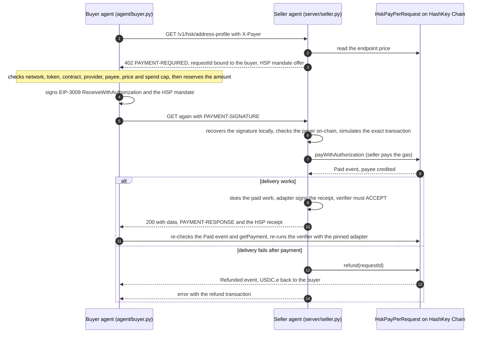
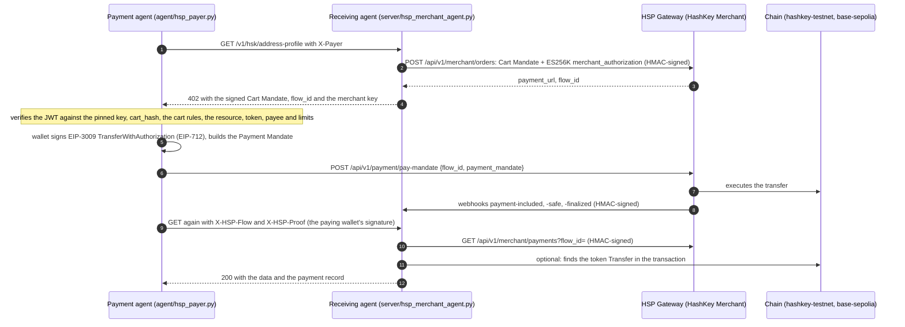

# HSK Meter

[](https://github.com/swiftbotlab/hsk-meter/actions/workflows/ci.yml)

**One agent pays another for every API request, in USDC.e on HashKey Chain, settled on-chain per request.**
If the seller cannot deliver after it has been paid, the payment is refunded on-chain automatically, and on the
default x402 path the buyer needs no gas token. With an HSP-style mandate attached, the seller ships the data only after a verifier has
checked the adapter-signed receipt against the buyer's signed mandate.

By Swift Bot Labs, for the HashKey Chain Horizon Hackathon (India), track **Agent Payments & A2A Settlement**.

**Watch the overview on YouTube (1:17):** [youtu.be/t2yyd76qRlc](https://youtu.be/t2yyd76qRlc): a paid call on
mainnet, an automatic refund, one agent paying another, and the HSP rail, with captions. The full 2:54 walkthrough
is under [At a glance](#at-a-glance).

## Try it now

**Always-on public endpoint: [hsk-meter.swiftbotlab.workers.dev](https://hsk-meter.swiftbotlab.workers.dev)**, on
HashKey Chain mainnet. It holds no private key: you pay the settlement contract yourself, and the endpoint checks that
payment on-chain before it answers. Each payment buys one response; a replay is refused.

```sh
# 1. Ask for a price: a real x402 v2 "402 Payment Required", with a requestId bound to your address and this request
curl -i "https://hsk-meter.swiftbotlab.workers.dev/v1/hsk/address-profile?address=0x78C8476772BC209C3df09Da5e129d0879cd57F8c" \
  -H "X-Payer: 0xYourAddress"

# 2. Pay and get the data (approve + pay() from your wallet, then the paid retry; needs 0.03 USDC.e and a little HSK)
python3 agent/buyer.py "https://hsk-meter.swiftbotlab.workers.dev/v1/hsk/address-profile?address=0x78C8476772BC209C3df09Da5e129d0879cd57F8c" \
  --scheme tx --key-file buyer.env \
  --expect-provider 0x30CCc6d816854d1a66fBfecE15b1515a3E941160 --expect-payee 0xA8A49A6Ca872D54a8FD5FB121139De9bff62a48D

# 3. Check any payment, free: ACCEPT or REJECT, with every check (this one is a live paid call to the endpoint)
curl "https://hsk-meter.swiftbotlab.workers.dev/v1/receipt/0x0c70d8276b168b04888595a5a3e2cf4d0dedcd148ab0946f5bdfdca7f388a282"
```

Step 2 works with any wallet too: `cast send` the `approve` and `pay(endpointId, requestId, amount)` calls shown on the
[endpoint's home page](https://hsk-meter.swiftbotlab.workers.dev), then repeat step 1 with `X-Paywall-Token` and
`X-Paywall-Tx`. Free routes: `/.well-known/x402`, `/health`, `/v1/receipt/{requestId or tx hash}`, `/v1/refunds`.
How it works and what "keyless" changes: [Public endpoint](#public-endpoint-keyless).

## Track 2 fit

The track asks for "the A2A scenario combined with HSP's API interface, where the Payment Agent constructs a Payment
Mandate based on the payment conditions transmitted by the receiving Agent, completes the wallet signature, and then
verifies and executes the on-chain payment through the existing Gateway of HSP." Here is where each part of that
sentence lives in this repository, and how far it has been proven.

| The listing says | HSK Meter component | Proven by |
|---|---|---|
| A2A scenario | `agent/agent_b.py` (Agent B) pays `server/seller.py` (Agent A) to make its own answer | live on mainnet: 3 runs and a composed refund, see [A2A](#agent-to-agent-a2a-a-seller-that-is-also-a-buyer) |
| the receiving Agent transmits the payment conditions | `server/hsp_merchant_agent.py`: turns a priced request into a **Cart Mandate**, signs it (ES256K `merchant_authorization`), registers it at the HSP gateway (`POST /api/v1/merchant/orders`, HMAC) and answers `402` with it | offline tests against our mock gateway |
| the Payment Agent constructs a Payment Mandate | `agent/hsp_payer.py`: checks the cart against a pinned merchant key, `cart_hash`, the documented cart rules, the resource, payee and AP2 spending limits, then builds the **Payment Mandate** in the wire format the hosted checkout uses | offline tests; field-by-field sources in [HSP_STATUS.md](HSP_STATUS.md#payer-wire-format-unverified-against-a-live-gateway) |
| completes the wallet signature | EIP-3009 `TransferWithAuthorization` (EIP-712) over the token's domain as read on-chain, inside the mandate's x402 v2 `payment_payload` | offline tests, plus an independent Node.js check of the encoding |
| verifies and executes through the existing Gateway of HSP | `server/hsp_gateway.py`: HashKey Merchant client (orders, payment queries, signed webhooks) and submission to `POST /api/v1/payment/pay-mandate` | built and tested against the mock; **not yet run against the live HSP gateway**: merchant credentials are requested and not issued |
| the on-chain payment, on HSK Chain mainnet | [`HskPayPerRequest` `0x78C8…7F8c`](https://hsk.blockscout.com/address/0x78C8476772BC209C3df09Da5e129d0879cd57F8c): per-request settlement in USDC.e with on-chain refunds | live: 63 transactions, 48 paid requests, 9 refunds (all endpoints, 2026-10-29); [live proof](#live-proof-on-mainnet), [public endpoint](#public-endpoint-keyless) and [dashboard](https://swiftbotlab.github.io/hsk-meter/) |

## Self-check: six judging dimensions

| Dimension | What there is to check | Evidence |
|---|---|---|
| Track fit | every phrase of the track text maps to a component (table above); HSP is used as documented on the merchant side and as the checkout uses it on the payer side | [HSP gateway](#hsp-gateway-cart-mandate-payment-mandate-gateway), [HSP_STATUS.md](HSP_STATUS.md) |
| Completeness | verified contract on mainnet, an always-on public endpoint you can pay, seller, buyer CLI, MCP server, a second agent that buys from the first, live dashboard, demo video, the HSP gateway rail | [try it now](#try-it-now), [live proof](#live-proof-on-mainnet), [dashboard](https://swiftbotlab.github.io/hsk-meter/), [video](https://swiftbotlab.github.io/hsk-meter/hsk-meter-demo.mp4) |
| Team | Swift Bot Labs; how we work | [Team](#team) |
| Solution value | an API can charge 0.025-0.08 USDC.e per call, settled on-chain per request, and the payment comes back automatically when delivery fails; the buyer needs no gas token | [How a request is paid](#how-a-request-is-paid) |
| Authenticity | every number links to a transaction; what is not done is written down (no live HSP gateway run yet) | [live proof](#live-proof-on-mainnet), [what waits on HashKey](HSP_STATUS.md#what-waits-on-hashkey) |
| Code quality | CI on every push runs 359 tests: 216 Python tests with the network refused by a guard (4 more are online-only), 53 tests of the public endpoint, 35 dashboard tests and 55 Foundry tests (unit, fuzz, invariants); guards mutation-checked; security notes per component | [CI](https://github.com/swiftbotlab/hsk-meter/actions/workflows/ci.yml), [SECURITY.md](SECURITY.md), [Run the tests](#run-the-tests) |

## At a glance

**Live dashboard:** [swiftbotlab.github.io/hsk-meter](https://swiftbotlab.github.io/hsk-meter/) reads the contract's
events straight from the public explorer in your browser: totals, USDC.e per day, refund rate and the latest payments,
each linked to its transaction.

**Overview video (1:17, captions):** [YouTube](https://youtu.be/t2yyd76qRlc).

**Demo video (2:54, English voice-over):** [watch in the browser](https://swiftbotlab.github.io/hsk-meter/hsk-meter-demo.mp4)
or [download it from the v1.0.0 release](https://github.com/swiftbotlab/hsk-meter/releases/download/v1.0.0/hsk-meter-demo.mp4).
It shows rows 24-26 of the live-proof table being paid on mainnet, the MCP buyer, a refund, the APRO price feeds and
the KYC SBT compliant mode.

| Component | Details |
|---|---|
| Network | HashKey Chain mainnet, chain id `177` |
| Settlement contract | [`HskPayPerRequest` `0x78C8476772BC209C3df09Da5e129d0879cd57F8c`](https://hsk.blockscout.com/address/0x78C8476772BC209C3df09Da5e129d0879cd57F8c?tab=contract), source verified on Blockscout and [Sourcify](https://repo.sourcify.dev/177/0x78C8476772BC209C3df09Da5e129d0879cd57F8c) (exact match) |
| Settlement token | USDC.e [`0x054ed45810DbBAb8B27668922D110669c9D88D0a`](https://hsk.blockscout.com/token/0x054ed45810DbBAb8B27668922D110669c9D88D0a) (Circle `FiatTokenV2_2`, EIP-3009) |
| Payment protocol | x402 v2 (`402 Payment Required`, `PAYMENT-SIGNATURE`, `PAYMENT-RESPONSE`), network `eip155:177` |
| Seller | provider [`0x30CCc6d816854d1a66fBfecE15b1515a3E941160`](https://hsk.blockscout.com/address/0x30CCc6d816854d1a66fBfecE15b1515a3E941160), endpoints `1` and `2` |
| HashKey ecosystem | APRO price feeds (USD value of quotes and totals, gas guard) and an optional KYC SBT compliant mode, see [HashKey ecosystem](#hashkey-ecosystem) |
| HSP gateway | a HashKey Merchant (HSP) rail for the same requests: Cart Mandate, Payment Mandate, HSP Gateway; built from the official API docs, tested against a mock gateway, switches on with merchant credentials, see [HSP gateway](#hsp-gateway-cart-mandate-payment-mandate-gateway) |

## Live proof on mainnet

Every row is a real request made over HTTP through the seller in this repository, paid by the buyer client in
this repository. Rows 1-5 ran v0.1 at the launch prices; rows 6-23 ran the hardened v0.2 inside its sandbox, and rows
23 and 25 were paid by an MCP client through `agent/mcp_server.py`. Rows 24-26 ran v0.3.0 for the demo video. The [dashboard](https://swiftbotlab.github.io/hsk-meter/)
recomputes the totals from the chain.

| # | Request | Payment path | Transaction |
|---|---|---|---|
| 1 | address profile, 0.01 USDC.e | x402 `exact` + HSP-style mandate, buyer paid no gas, verifier ACCEPT | [`0x98526a6b…`](https://hsk.blockscout.com/tx/0x98526a6b276b3763cde68297c29f89f194a5fed99a0add55794f57ece123da79) |
| 2 | tx check (of #1), 0.005 | x402 `exact` | [`0x672b4957…`](https://hsk.blockscout.com/tx/0x672b495773c17c6216ec24d7981091d2209d43e545e17b463a7c9744d830dfc5) |
| 3 | tx check of a hash that does not exist, 0.005 | x402 `exact`, then automatic **refund** | paid [`0x63d7f42d…`](https://hsk.blockscout.com/tx/0x63d7f42d638b79fb1a16404ca025a1524c6c635f601c6f99d8c0df611f4a0f52), refunded [`0xaa744ebd…`](https://hsk.blockscout.com/tx/0xaa744ebdacf908b511dd5e23cc592cd49c55e9f466012a0b26e3388e909c40fc) |
| 4 | address profile, 0.01 | buyer calls `pay()` itself and proves it | [`0xfb36cf54…`](https://hsk.blockscout.com/tx/0xfb36cf54ef11efccca707b465ac9ff95dda1f075eab59136485369ce76783856) |
| 5 | tx check, 0.005 | x402 `exact`; the same header replayed: served 3 times, settled once, then refused | [`0x04ddbc59…`](https://hsk.blockscout.com/tx/0x04ddbc5973a69cd5620f3eb516b6ddbc6be2be4630efeda507fa3ca0c181917e) |
| 6 | address profile, 0.03 | x402 `exact` + HSP-style mandate, verifier ACCEPT, adapter pinned | [`0x5bf9515b…`](https://hsk.blockscout.com/tx/0x5bf9515b09692b156cfbe080b451ab0a8a74e2a2e41e2bb8d93aecc0f770a7c9) |
| 7 | tx check, 0.025 | x402 `exact` | [`0x3a88578a…`](https://hsk.blockscout.com/tx/0x3a88578a594d3e16d493c68fd168e20e0a750d92ce16bd7f216721877f7147ca) |
| 8 | address profile, 0.03 | x402 `exact`; delivery failed (operator test switch), automatic **refund** | paid [`0x543e14fb…`](https://hsk.blockscout.com/tx/0x543e14fbf0aa9e15932405e70df912bca1d0b1da40be8b33ad1d4b88e557f9b5), refunded [`0xd6e4e725…`](https://hsk.blockscout.com/tx/0xd6e4e7257aa7a472566dc0a27712b58a23b556a9ddb39e93504f582707fdfb0c) |
| 9 | address profile (settlement contract), 0.03 | x402 `exact` + HSP-style mandate, verifier ACCEPT, adapter pinned | [`0x68113c45…`](https://hsk.blockscout.com/tx/0x68113c4551acc6264b4d13bbb57772056cc4e8fbff365b744213f45ec78b88d1) |
| 10 | tx check (the deployment), 0.025 | x402 `exact` | [`0x81bf3c5c…`](https://hsk.blockscout.com/tx/0x81bf3c5cd505309e733ab0bc243cacccd44401dfe070fbd612b85f9bd4bf4ba7) |
| 11 | address profile (USDC.e), 0.03 | x402 `exact` + HSP, verifier ACCEPT | [`0x88fe48d3…`](https://hsk.blockscout.com/tx/0x88fe48d3bc73b097f63e8025f6e8ea0262484f155609a293d1deb75855a76082) |
| 12 | address profile (settlement contract), 0.03 | x402 `exact` + HSP, verifier ACCEPT | [`0x2b5d7f4e…`](https://hsk.blockscout.com/tx/0x2b5d7f4e33e7ba676c9a8e2dd28d79ad2c3b2674f34b23cfefa38687f3902a05) |
| 13 | tx check (of #6), 0.025 | x402 `exact` + HSP, verifier ACCEPT | [`0xe1024acd…`](https://hsk.blockscout.com/tx/0xe1024acdbc23afb4b21b3aff37c197edae98efb9b1a998d160df8163de80eb3a) |
| 14 | address profile (WHSK), 0.03 | x402 `exact` | [`0xfc2b96a9…`](https://hsk.blockscout.com/tx/0xfc2b96a94da5b9fa1f35a9d05d52ad0a09161ee564dc32a0fe5c31f07636d72a) |
| 15 | tx check (a gas transfer), 0.025 | x402 `exact` | [`0xd6d0e74d…`](https://hsk.blockscout.com/tx/0xd6d0e74d10f844e389aff0622549f6acf1cbdaa0117e25d32ca5d4a4635ec111) |
| 16 | address profile, 0.03 | x402 `exact`; delivery failed (operator test switch), automatic **refund** | paid [`0xb29f7615…`](https://hsk.blockscout.com/tx/0xb29f76152830d5876784a1362fdd4a757bdf0b1f6cfcffca11d01108d00f0d60), refunded [`0xa2fe58d3…`](https://hsk.blockscout.com/tx/0xa2fe58d3002a3601bb81b8b3cf1178ef07061abbc69b9870131d76f2f5d7ae86) |
| 17 | tx check (of #1), 0.025 | x402 `exact` + HSP, verifier ACCEPT | [`0xca40a411…`](https://hsk.blockscout.com/tx/0xca40a4110135d85cc55ab6b16096ae3cce4b76e95e6ff7ab96e76fdc125faf62) |
| 18 | address profile (provider), 0.03 | buyer approves and calls `pay()` itself | approve [`0x2a9ab663…`](https://hsk.blockscout.com/tx/0x2a9ab6631e49cdfb214712882c18e9e0bc150914f03d85eb232e6edece7cd696), pay [`0xdec751cc…`](https://hsk.blockscout.com/tx/0xdec751cc9b3cf810cb4615b4d869e417d1174b0857d7de43064b056ba86e5036) |
| 19 | tx check (of #7), 0.025 | x402 `exact` | [`0x33cfa3fa…`](https://hsk.blockscout.com/tx/0x33cfa3fa4af5ec3f1b9b55da35829f9d276a276ae686c3f88580806532c420d3) |
| 20 | address profile (USDT), 0.03 | x402 `exact` + HSP, verifier ACCEPT | [`0xa9843546…`](https://hsk.blockscout.com/tx/0xa984354601db631fde9f7dabea9bcac2e2706a485f38a5b1ab993254df04e87f) |
| 21 | tx check (a gas transfer), 0.025 | x402 `exact` | [`0x3573a1e7…`](https://hsk.blockscout.com/tx/0x3573a1e743dc982b3f93094696f0afa58886a6ad4a5f20181dcd1bb6cb714745) |
| 22 | address profile (payee), 0.03 | x402 `exact` | [`0xfad63c27…`](https://hsk.blockscout.com/tx/0xfad63c27ba1cf8a89a2f2510340d7b8113bb64c890bf27e9dc403c1dee1d20d7) |
| 23 | tx check (of #22), 0.025 | paid through the MCP tool `hsk_meter_pay`: x402 `exact` + HSP, verifier ACCEPT | [`0x8eea4457…`](https://hsk.blockscout.com/tx/0x8eea4457da07928d2f0d3ba465da6770188c4e1f4f9dc4a848d3d081294ddc37) |
| 24 | address profile (settlement contract), 0.03 | x402 `exact` + HSP-style mandate, verifier ACCEPT, adapter pinned (recorded for the demo video) | [`0xe83e2679…`](https://hsk.blockscout.com/tx/0xe83e2679ea005d37f9721e94ac825ab84ae2da0150bb2d64abe61aa04c1f442f) |
| 25 | tx check (of #24), 0.025 | paid through the MCP tool `hsk_meter_pay`: x402 `exact` + HSP, verifier ACCEPT; the same URL called again was re-served without a new payment | [`0xa28f6e62…`](https://hsk.blockscout.com/tx/0xa28f6e62612854937c464c43ef52333fc6f0ef97b8a950a0d716806586227205) |
| 26 | address profile, 0.03 | x402 `exact`; delivery failed (operator test switch), automatic **refund** | paid [`0xf356a18a…`](https://hsk.blockscout.com/tx/0xf356a18abe71d3d4d3a898ff90986f1a4e63f7e2db1af652eea2de73f70a3ff0), refunded [`0x67066923…`](https://hsk.blockscout.com/tx/0x67066923291f05889e8ad9ad578e2773aead3fef5b99cd81384425e21ab6e961) |

Setup transactions: deployment [`0xe08891e3…`](https://hsk.blockscout.com/tx/0xe08891e35a7197a62a5cb165a6e2dea194842f3dba00711fc65207cec120fe73),
endpoint registrations [`0xec7dd370…`](https://hsk.blockscout.com/tx/0xec7dd370d753d746a264e3bd13acdca1733b323132e5cbe5184a573ec56f27b4)
and [`0x97e3dd2d…`](https://hsk.blockscout.com/tx/0x97e3dd2d6b5cc86a0a81231f84deaf6ae706bbbcf6a2bf916c3750f170464a82),
price changes [`0x62188d0a…`](https://hsk.blockscout.com/tx/0x62188d0abc975d81fd2212ea2197dd2d990fd2be3a168a48b7ba995a58980ef4)
and [`0x86e73f35…`](https://hsk.blockscout.com/tx/0x86e73f35a5ebb00efc93b8cc449838b812ec601ccb336e904c99530832b6576c),
payee withdrawal [`0x159f8304…`](https://hsk.blockscout.com/tx/0x159f830494dd86272b9e2ba53d9801a5b4a3c190f38a5ef46a54ccf36e67bbe8).

Prices are set on-chain per endpoint: address profile **0.03 USDC.e**, transaction check **0.025 USDC.e**. Each
price covers at least twice the worst settlement gas measured (246,503 gas at 500 gwei = 0.123 HSK, about $0.011),
because the seller pays the gas of every `exact` settlement.

> [!NOTE]
> Anyone can register endpoints on the contract, so contract-wide totals are not this service's numbers. Count only
> endpoints `1` and `2` of provider `0x30CCc6d816854d1a66fBfecE15b1515a3E941160`.

## Agent-to-agent (A2A): a seller that is also a buyer

The track asks for agents that "discover, collaborate, and transact." `agent/agent_b.py` is a second seller —
**Agent B**, a HashKey address *risk brief* at endpoint `3` (`GET /v1/hsk/risk-brief`, 0.08 USDC.e). To produce
its answer, Agent B does not hold the raw data: it **pays Agent A** (this repository's seller, endpoint `1`)
over the same x402 rail, from its own wallet, and composes a risk score on top. So **one** end-buyer request
triggers **two** on-chain settlements between **distinct** wallets, with a margin for Agent B:

- end-buyer `0x5270…A361` → Agent B's payee `0xD680…4A83` (endpoint 3, 0.08 USDC.e)
- Agent B's buyer `0x7A03…4130` → Agent A's payee `0xA8A4…a48D` (endpoint 1, 0.03 USDC.e)

Agent B reuses the seller, settlement, refund and x402/EIP-3009 code unchanged; it only swaps in endpoint 3 and
pays upstream through `agent/buyer.py`. Endpoint 3 registered on-chain:
[`0x5c8f458d…`](https://hsk.blockscout.com/tx/0x5c8f458da639d2852c5ee0a0ef5c246005df8c80945ed061b9787a69e212bcfc).

| A2A run | risk brief on | end-buyer → Agent B (ep3) | Agent B → Agent A (ep1) |
|---|---|---|---|
| 1 | the settlement contract | [`0x7771c755…`](https://hsk.blockscout.com/tx/0x7771c755d0c1f026089521f6bd30ae58ded8aa8250ff8bfca5922f9cecceec85) | [`0xf8df895c…`](https://hsk.blockscout.com/tx/0xf8df895c55f1cc63b9bb80429ecea1cb758e386d71020599aa518fea80fcd4b4) |
| 2 | an EOA | [`0x29b0c35a…`](https://hsk.blockscout.com/tx/0x29b0c35acdfcbe4d074fc52bb713cdeb12acc87e74d0f169380c401f4a2653df) | [`0x65572b77…`](https://hsk.blockscout.com/tx/0x65572b77697029f73775eed4efb22640908c5c5663330b64ad91ee350d14eff4) |
| 3 | the APRO USDC/USD feed | [`0xa69e680a…`](https://hsk.blockscout.com/tx/0xa69e680a7adbe8f0910859e46eaa57b1b3ec4434aa63072c575ad3ac22a8e4f6) | [`0x0e050d7e…`](https://hsk.blockscout.com/tx/0x0e050d7ec20c76eaeb6699cf0417dc63f936751ace082ed58a6b31da4a20f630) |

**Composed refund.** When Agent A cannot deliver, it refunds Agent B; Agent B then cannot deliver either, so it
refunds the end-buyer. Both levels unwound on mainnet in one run, and both wallets ended exactly where they
started:

| step | paid | refunded |
|---|---|---|
| end-buyer → Agent B (ep3) | [`0xee9845cb…`](https://hsk.blockscout.com/tx/0xee9845cb16222270a985b456429c570c93aa1438557b681dd57d06ca7ca112fe) | [`0xf407cf85…`](https://hsk.blockscout.com/tx/0xf407cf858764e189aa3c4417e1f2551b7449c03e710b91fde07506a85abd0d6a) |
| Agent B → Agent A (ep1) | [`0xddedc886…`](https://hsk.blockscout.com/tx/0xddedc8869549d0be05495087b4d7526f2f1c1610bd10bfacbb3fae17171d98b3) | [`0xf8aa291d…`](https://hsk.blockscout.com/tx/0xf8aa291d90e9a937dcff64eb123ec1b0db49c4ce54824f6d924560992e3a91b7) |

Run it yourself with `agent/A2A_DEMO.md`. The four A2A endpoint-1 settlements above are included in endpoint 1's
on-chain count (now 18 paid / 4 refunded); endpoint 3 is Agent B's own provider and is counted separately.

## How a request is paid



The contract (`contracts/src/HskPayPerRequest.sol`, no admin, no upgrades, nothing payable):

- Providers register priced endpoints; a payee must consent to the provider that pays it.
- `payWithAuthorization` pulls exactly the price with USDC.e `receiveWithAuthorization`. The EIP-3009 nonce must equal
  `authorizationNonce(endpointId, requestId) = keccak256(abi.encode(contract, endpointId, requestId))`, so one signature
  pays one request on one endpoint and nothing else. Only the contract can execute a `ReceiveWithAuthorization`, so a
  copied signature cannot be front-run into a bare transfer.
- `pay(endpointId, requestId, amount)` is the same payment for buyers that approve and pay themselves.
- A `requestId` carries its payer in the top 20 bytes, so nobody else can pay (or burn) it, and it is paid at most once.
- Price changes apply to new payments only; a stale quote gets `WrongAmount`, never a different charge.
- The provider can refund a paid request once, out of the payee's unwithdrawn credit. Payees pull their credit with
  `withdraw`.

### x402 v2 profile

Standard parts: the `PAYMENT-REQUIRED` / `PAYMENT-SIGNATURE` / `PAYMENT-RESPONSE` headers (base64 JSON),
`x402Version: 2`, `accepts[]` with `scheme: "exact"`, `network: "eip155:177"`, `amount`, `asset`, `payTo`,
`maxTimeoutSeconds`, and a `PaymentPayload` of `{signature, authorization: {from, to, value, validAfter, validBefore, nonce}}`.

Specific to this rail (declared in `accepts[0].extra`): the signed type is `ReceiveWithAuthorization`
(`primaryType`, `settlement: "contract"`), `payTo` is the settlement contract, and the nonce comes from the quote
(`extra.nonce`) because it binds the payment to one request. A client that signs a random-nonce
`TransferWithAuthorization` is refused before anything is sent. `accepts[1]` (`hsk-paywall-tx`) is the self-paid
alternative. Optional `extensions` of the `402`: `hsp-draft` (the mandate offer), `usd-estimate` (the price in USD from
the APRO feed) and `kyc-sbt` (only in compliant mode).

## Quickstart

Requirements: Python 3 (tested with 3.14) and `pip install -r requirements.txt` (pinned `eth-account`, `eth-abi`,
`eth-utils`, `hexbytes`). Key files hold one `NAME=0x...` value each, mode `0600`, and are never committed.

### Buyer: pay for a request

The buyer needs USDC.e on HashKey Chain and no HSK (the seller pays the gas of `exact` settlements).

```sh
echo "HKPW_BUYER_PK=0x..." > buyer.env && chmod 600 buyer.env      # your buyer key, kept out of the repo

python3 agent/buyer.py "http://localhost:8402/v1/hsk/address-profile?address=0x78C8476772BC209C3df09Da5e129d0879cd57F8c" \
  --key-file buyer.env \
  --expect-provider 0x30CCc6d816854d1a66fBfecE15b1515a3E941160 \
  --expect-payee 0xA8A49A6Ca872D54a8FD5FB121139De9bff62a48D \
  --max-price 0.05 --session-cap 0.20 \
  --hsp --pin-adapter 0x4D281e0a98fD40Bb824F88D5e037bd8d03C4403a
```

`http://localhost:8402` is the full seller you run yourself (see "Seller" below and "Try it yourself"). It holds a
hot settlement key, so it pays the gas of `exact` payments and refunds automatically. The always-on
[public endpoint](#public-endpoint-keyless) holds no key and takes `--scheme tx` payments.

The buyer refuses to sign unless the quote is for chain 177, USDC.e, this contract, the pinned provider and payee,
and the on-chain price, and unless the amount fits under `--max-price` and the session cap. It then verifies the
`Paid` (or `Refunded`) event and `getPayment` itself. `--scheme tx` pays with its own `pay()` transaction instead
(that needs a little HSK for gas).

### Seller: sell an API per request

1. Register your endpoints on the contract from a provider key, and let the payee consent once, for example with
   Foundry's `cast` and an encrypted keystore account:

   ```sh
   RPC=https://mainnet.hsk.xyz; METER=0x78C8476772BC209C3df09Da5e129d0879cd57F8c
   cast send $METER "approveProvider(address,bool)" $PROVIDER true --rpc-url $RPC --account payee
   cast send $METER "registerEndpoint(uint128,address,string)" 30000 $PAYEE "GET /v1/your/path" --rpc-url $RPC --account provider
   ```

   Prices are in USDC.e base units (6 decimals): `30000` = 0.03 USDC.e.
2. Map each paid path to its endpoint id in `RESOURCES` in `server/seller.py`.
3. Put three files in a key directory: `provider.env` (`HKPW_PROVIDER_PK`), `adapter.env` (`HKPW_ADAPTER_PK`, signs
   HSP receipts) and `token.env` (`PAYWALL_TOKEN_KEY`, 32 random bytes in hex). The payee key never goes on the server.
4. Run it in the bubblewrap sandbox (recommended) or directly:

   ```sh
   HSK_METER_KEY_DIR=/path/to/keys HSK_METER_VENV=/path/to/venv deploy/run_sandboxed.sh seller --port 8402
   python3 server/seller.py --key-dir /path/to/keys --port 8402      # without the sandbox
   ```

   For a long-running seller, install the systemd user unit template `deploy/hsk-meter-seller.service` (restarts on
   failure; `systemctl --user stop` stops the whole sandbox).

   Free routes: `GET /`, `GET /health`, `GET /.well-known/x402`. The payee withdraws earned credit with
   `withdraw(to, amount)` from its own wallet. Options for the [HashKey ecosystem](#hashkey-ecosystem) reads:
   `--require-kyc basic|advanced|premium|ultimate` (compliant mode, off by default), `--kyc-sbt 0x...`,
   `--no-price-feeds`, `--hsk-usd` (the gas guard's HSK price floor).

### Try it yourself

The quickest way is the always-on [public endpoint](#public-endpoint-keyless) (see [Try it now](#try-it-now)). For
the full seller, with the gasless `exact` scheme, automatic refunds and the HSP-style receipts, you run the seller and
pay it yourself — one terminal each. Free routes need no payment: `curl http://localhost:8402/.well-known/x402` returns
the full x402 terms, and `GET /health` the live endpoint prices. A paid call looks like this (real mainnet
response, trimmed):

```
$ python3 agent/buyer.py "http://localhost:8402/v1/hsk/address-profile?address=0x78C8476772BC209C3df09Da5e129d0879cd57F8c" ... --hsp
{
  "data": {"address": "0x78c8…57f8c", "chainId": 177, "type": "contract", "codeSize": 8726, "nonce": 1,
           "balances": {"HSK": "0.000000", "USDC.e": "0.620000", "USDT": "0.000000", "WHSK": "0.000000"},
           "block": 29339139, "explorer": "https://hsk.blockscout.com/address/0x78c8…57f8c"},
  "payment": {"endpointId": 1, "amount": "30000", "tx": "0x…", "network": "eip155:177"},
  "hsp": {"decision": {"outcomeClass": "ACCEPT", ...}},
  "delivered": true, "payment_state": "settled"
}
```

For the two-hop A2A flow (Agent B pays Agent A), see `agent/A2A_DEMO.md`.

## Public endpoint (keyless)

[hsk-meter.swiftbotlab.workers.dev](https://hsk-meter.swiftbotlab.workers.dev) is a Cloudflare Worker (`worker/`)
that sells the same two requests as `server/seller.py`, under the same wire protocol, and is always on. It holds no
private key, so it takes the self-paid scheme only:

1. `GET` a paid route with `X-Payer` → `402`, `PAYMENT-REQUIRED` mirrored in the body, `accepts[0]` with scheme
   `hsk-paywall-tx`, the on-chain price, the contract, the quote token and the `requestId` (derived exactly as in
   `server/protocol.py`: bound to the payer, the endpoint and this exact resource).
2. The buyer calls `approve` and `pay(endpointId, requestId, amount)` on the contract from its own wallet.
3. The same `GET` with `X-Payer`, `X-Paywall-Token` (and optionally `X-Paywall-Tx`) → the Worker reads
   `getPayment(requestId)` and the `Paid` log by request id, checks payer, endpoint, amount, payee, refund flag and
   age, claims the request id in its served-set, and answers `200` with the data, the payment and `PAYMENT-RESPONSE`.
   The body has the same shape as the seller's answer; `worker/test/test_buyer_compat.py` checks that the data is
   identical to what `server/seller.py` computes from the same chain state.

| | Full seller (`server/seller.py`) | Public endpoint (`worker/`) |
|---|---|---|
| Keys on the server | provider key (hot), HSP adapter key, quote-token key | quote-token key only (cannot move funds) |
| Payment schemes | `exact` (gasless for the buyer) and `hsk-paywall-tx` | `hsk-paywall-tx` (the buyer pays gas) |
| Refund when delivery fails | automatic, on-chain | listed at `/v1/refunds`; the provider sends `refund(requestId)` |
| Responses per payment | up to 3 within 1 h (lost-answer retries) | 1; a replay gets `429 already_served` |
| HSP-style receipts, APRO USD estimate | yes | no |
| Runs | on demand, in a bubblewrap sandbox | always, on Cloudflare (served-set in a Durable Object per request id) |

`GET /v1/receipt/{requestId or tx hash}` is a free verifier for any payment on the contract: it decodes the `Paid` and
`Refunded` events, cross-checks `getPayment`, and answers `ACCEPT` only when the payment is on-chain, matches its
event, is not refunded and was made to an endpoint of this service (optional `?payer=`, `?endpoint=`, `?amount=`
expectations). Details and the threat model: [SECURITY.md](SECURITY.md#public-endpoint-worker-cloudflare-worker-keyless).

Live paid calls to the public endpoint (buyer `agent/buyer.py --scheme tx`, unchanged):

| # | Request | Result | Transactions |
|---|---|---|---|
| W1 | address profile (settlement contract), 0.03 | `200` with the data; the buyer resent the same paid request: `429 already_served`, not charged again | approve [`0x4653b446…`](https://hsk.blockscout.com/tx/0x4653b446bd90cb0a739fed384c9e386836bf5405a78c5291963e61e67feb34d9), pay [`0x0c70d827…`](https://hsk.blockscout.com/tx/0x0c70d8276b168b04888595a5a3e2cf4d0dedcd148ab0946f5bdfdca7f388a282) |
| W2 | tx check (of W1's payment), 0.025 | `200`; the data is identical to what `server/seller.py` computes for the same transaction; the paid headers replayed twice by hand: `429 already_served` both times | approve [`0x572624a5…`](https://hsk.blockscout.com/tx/0x572624a5fa7459cc0c490d69c97c812ff1391ad7469c57f8c1de39f8305d46c8), pay [`0xff58e942…`](https://hsk.blockscout.com/tx/0xff58e942ad8cb5ab1f1361bd1f630eb220accc143983fb9111546c3d49acc3ce) |
| W3 | address profile (payee), 0.03 | `200` with the data | approve [`0x1dab8ceb…`](https://hsk.blockscout.com/tx/0x1dab8ceb2c2a011574bfb432eb41f700726ba6a64697c60b182768e8515afaa8), pay [`0xa1b22866…`](https://hsk.blockscout.com/tx/0xa1b2286647948b016f9ece81f4ddab3206322c76ffa078a63f6135245aaaa523) |

Each row can be re-checked with the free verifier, for example
`curl https://hsk-meter.swiftbotlab.workers.dev/v1/receipt/0xff58e942ad8cb5ab1f1361bd1f630eb220accc143983fb9111546c3d49acc3ce`
(`ACCEPT`, served once by this endpoint).

Deploy your own: `cd worker && npm ci && npx wrangler deploy`, then `npx wrangler secret put PAYWALL_TOKEN_KEY` (32
random bytes in hex, from stdin) and change the constants at the top of `worker/src/core.js` (contract, provider,
payee) to yours. `node worker/test/run.mjs` runs its tests offline.

## Use it from any MCP client

`agent/mcp_server.py` runs the buyer as an MCP server over stdio (no extra dependencies), so any MCP-capable agent
can pay HSK Meter sellers per request. It offers three tools:

| Tool | What it does |
|---|---|
| `hsk_meter_quote` | fetches the seller's x402 terms for a URL and runs the spend guard on them, and returns the price in USD (`amountUsd`) from its own read of the APRO USDC/USD feed; signs and pays nothing |
| `hsk_meter_pay` | pays one request (optionally with the HSP-style mandate) and returns the data plus the settlement transaction, or the refund; `new_purchase: true` pays again for a URL it delivered in the last 10 minutes |
| `hsk_meter_status` | session spend (spent, reserved, cap, remaining), payments waiting to be resent or re-served, and the buyer's USDC.e balance |

The operator sets the limits when starting the server; the client cannot change them. These are the key, the seller
origins it may pay, the pinned provider, payee and HSP adapter, the per-request price limit (a client may pass a lower
`max_price`, never a higher one), the session cap and payments per minute. Seller data is returned as untrusted content.
Retries never pay twice. If a paid answer is lost or unreadable, the next `hsk_meter_pay` for the same URL resends the
same signed payment (kept in the session ledger, so this also works after a restart). For 10 minutes after a delivery,
a call for the same URL, for example after the client timed out or cancelled the first one, is re-served for free
under that payment unless it passes `new_purchase: true`. A call returns within about 45 seconds, and the server honours
`notifications/cancelled`.

```json
{
  "mcpServers": {
    "hsk-meter": {
      "command": "python3",
      "args": ["/path/to/hsk-meter/agent/mcp_server.py",
               "--key-file", "/path/to/buyer.env",
               "--allow-origin", "http://localhost:8402",
               "--expect-provider", "0x30CCc6d816854d1a66fBfecE15b1515a3E941160",
               "--expect-payee", "0xA8A49A6Ca872D54a8FD5FB121139De9bff62a48D",
               "--pin-adapter", "0x4D281e0a98fD40Bb824F88D5e037bd8d03C4403a",
               "--max-price", "0.05", "--session-cap", "0.20"]
    }
  }
}
```

Rows 23 and 25 of the live-proof table were paid this way: quote, then `hsk_meter_pay` with HSP, over stdio from an MCP
client (row 25 also shows a retry of the same URL re-served without a new payment).

## HashKey ecosystem

HSK Meter reads two products that HashKey Chain recommends to builders. Both are reads only: nothing is signed or
sent, and a product that is unavailable never blocks a payment.

### APRO price feeds

| Feed (HashKey Chain mainnet) | Address | Used for |
|---|---|---|
| USDC/USD | [`0x244Ce344df8837c9d938867E2Ffbf0E4B0169B56`](https://hsk.blockscout.com/address/0x244Ce344df8837c9d938867E2Ffbf0E4B0169B56?tab=contract) | the USD value of every quote, the buyer's own USD view, the dashboard's USD total |
| HSK/USD | [`0x86CE42c1b714149Dc3A7b17169EF67b5F78A224b`](https://hsk.blockscout.com/address/0x86CE42c1b714149Dc3A7b17169EF67b5F78A224b?tab=contract) | the seller's per-sale gas guard |

- **Quotes.** Every `402` carries `extensions["usd-estimate"]`: the price in USD at the current USDC/USD round, with
  the feed address, round id and round time. It is informational; the amount to sign is still `accepts[].amount` in
  USDC.e.

  ```json
  "usd-estimate": {
    "priceUsd": "0.029994",
    "source": "APRO price feed, HashKey Chain mainnet",
    "feed": {"pair": "USDC/USD", "feed": "0x244Ce344df8837c9d938867E2Ffbf0E4B0169B56", "price": "0.99982693",
             "roundId": "18446744073709552295", "updatedAtIso": "2026-10-23T07:39:41Z", "...": "..."}
  }
  ```

- **Buyer and MCP.** `hsk_meter_quote` returns `amountUsd` computed from the buyer's own read of the feed, so an agent
  that budgets in USD never depends on the seller's number.
- **Gas guard.** The seller pays the gas of every `exact` settlement and refuses one whose expected fee is above the
  sale's value. It prices HSK at the higher of `--hsk-usd` (default 0.10) and the APRO HSK/USD answer, so the feed can
  only make the guard stricter. At today's HSK price (about $0.087) the floor applies; if HSK rises above $0.10, the
  guard follows the feed without operator action. Settlements use the cached reading (refreshed by quotes and every
  60 seconds) and never wait on a feed.
- **Dashboard.** "Net value in USD" converts the totals at the newest USDC/USD round, read from the feed aggregator's
  `AnswerUpdated` events on the explorer. The snapshot stores a checked `latestRoundData()` reading as the fallback.
- **Checks.** A reading is used only when the proxy reports the expected pair and 8 decimals, the round is finished,
  the answer is positive and in a sane range, the round time is not in the future and the round is at most 26 hours
  old. On mainnet these feeds post a round at least every 24 hours, plus updates when the price moves.

Both addresses are listed on the [HashKey Chain oracle page](https://docs.hskchain.net/docs/Build-on-HashKey-Chain/Tools/Oracle)
and were checked on-chain before use: verified `EACAggregatorProxy` source on Blockscout, `description()` and
`decimals()` match, and both were deployed by the same account as the other APRO feeds on that page. (The copy of the
oracle page in the docs' GitHub repository drops two characters of the HSK/USD address; the live page and the chain
agree on the address above.)

### KYC SBT compliant mode (optional, off by default)

`--require-kyc basic|advanced|premium|ultimate` makes the seller serve only payers that hold a valid HashKey Chain
[KYC SBT](https://docs.hskchain.net/docs/Build-on-HashKey-Chain/Tools/KYC) at that level:

- A quote is refused with `403 kyc_required` (free, nothing signed) unless `isHuman(payer)` returns valid at the
  required level. The refusal says why, from `getKycInfo`: no SBT, revoked, no longer valid, or level too low.
- The check runs again right before settlement, and before the first serve of a self-paid payment; a self-paid
  payment whose SBT lapsed in between is refunded on-chain.
- An unreadable SBT fails closed (`502`, nothing issued). The `402` states the requirement in
  `extensions["kyc-sbt"]`.

HSP's compliant payment scenario asks for a KYC attestation; this SBT check is an on-chain source for one, to be
wired into the HSP receipts once the HSP SDK is published.

> [!NOTE]
> The KYC page documents the interface but does not print a mainnet address. HSK Meter uses
> [`0x0f362c05fb3Fadca687648F412abE2A6d6450D70`](https://hsk.blockscout.com/address/0x0f362c05fb3Fadca687648F412abE2A6d6450D70),
> the mainnet address in the KYC provider's own demo configuration
> ([hunyuan-kyc/next-kyc-demo](https://github.com/hunyuan-kyc/next-kyc-demo/blob/main/.env.example)). Checked on-chain:
> `name()` is "KYC SBT", `symbol()` "KYC", `suffix()` ".hsk"; the documented `isHuman`, `getKycInfo`, `requestKyc` and
> `getTotalFee` selectors are in its code; both reads decode with the documented types; and `resolver()` returns the
> resolver address from the same file. Its source is not verified on the explorer, so `--kyc-sbt` can point the seller
> at another address. The demo seller runs with compliant mode off.

## Security model

Full details and the threat model are in [SECURITY.md](SECURITY.md). In short:

- **Contract:** no owner, no admin, no upgrade path, nothing payable; `nonReentrant` plus checks-effects-interactions
  everywhere; the payment amount must equal the price in force and the token balance delta must match; refunds happen
  at most once and only from the provider. Tests run against the real USDC.e implementation code read from HashKey
  Chain, including a model-based invariant suite; eight hand-written contract mutants were all caught by the unit tests.
- **Seller:** a payment is checked in order and nothing is sent until every step passes: local signature recovery, then
  the payer on-chain (plain account, balance, unused nonce), then a simulation with the exact gas and fee fields that
  get signed. Per-client, per-payer and global rate limits; separate daily gas budgets for settlements and refunds;
  a low-balance alert; atomic per-request reservation (a payment settles once and is served at most 3 times within an
  hour); a refunded payment is never served; state is journaled and replayed at start.
- **Public endpoint:** no private key at all; every paid answer is checked against `getPayment` and the `Paid` event
  first, and each payment is served once (a Durable Object per request id serializes claims across Cloudflare
  locations; a replay gets `429 already_served`). The only outbound host is the pinned RPC.
- **Isolation:** the seller runs under bubblewrap with only its code, its Python environment, its own key directory
  (read-only) and its state directory visible, and an in-process egress guard that allows only the RPC host.
- **Buyer and MCP server:** spend cap reserved before anything is signed, provider and payee pinned, every claim
  re-checked on-chain (refunds are read at the refund's block, so a lagging RPC node cannot hide one); the MCP client
  cannot raise any operator limit or reach origins outside the allowlist.
- **Ecosystem reads:** price feeds and the KYC SBT are read-only; a wrong feed can only tighten the gas guard, and an
  unreadable SBT fails closed.

## HSP gateway: Cart Mandate, Payment Mandate, Gateway

Track 2's flow, as the organizer describes it: the Payment Agent builds a Payment Mandate from the payment
conditions the receiving agent sends, completes the wallet signature, and the payment is verified and executed
on-chain by HSP's existing gateway. HSK Meter implements this against the
[HashKey Merchant API](https://hashkey-merchant.github.io/en/index.html), using the AP2 terms that API uses. The
merchant side follows the official docs. The docs do not publish the payer side, so the Payment Mandate follows the
wire format of the gateway's hosted checkout, as found in its client code in public prior art (sources and one open
conflict in [HSP_STATUS.md](HSP_STATUS.md#payer-wire-format-unverified-against-a-live-gateway)). Everything here runs
against our mock gateway; **none of it has run against the live HSP gateway yet**, because merchant credentials are
requested and not issued.



| HSK Meter | HSP / AP2 object |
|---|---|
| a priced request (endpoint, exact resource, price) | **Cart Mandate** `contents`: id `hskm-<endpoint>-<random>`, `details.id` = `payment_request_id`, one display item labelled with the exact resource, total = the endpoint price in USD (0.03 or 0.025), one USDC `method_data` row per network: hashkey-testnet (`133`, `0x8FE3cB71...`) and base-sepolia (`84532`, `0x036CbD53...`) |
| the receiving agent's signature | `merchant_authorization`: ES256K JWT with `cart_hash` = SHA-256 of the canonical contents; public key [`hsp_merchant_public_key.pem`](hsp_merchant_public_key.pem) |
| the payer's consent | **Payment Mandate**: `payment_mandate_contents` (`payment_mandate_id` = `payment_request_id`, a payer-generated `payment_details_id`, the cart's total, and `payment_response.details.payment_payload` = base64 of an x402 v2 PaymentPayload carrying the EIP-3009 authorization and its signature) plus `user_authorization` (HS256 JWT, `aud` `HashkeyMerchant`, `transaction_data` = SHA-256 of the canonical cart and of the mandate contents) |
| the buyer's spend guard | AP2 constraints: `payment.allowed_payees`, `payment.amount_range`, `payment.budget`, `payment.agent_recurrence`, reserved in a ledger before anything is signed |
| proof of payment before delivery | the gateway's payment record (status at least `payment-included`, tx hash, cart id, token, payee, amount, payer), its signed webhook, and optionally the token `Transfer` on-chain; the data goes only to the wallet that paid (`X-HSP-Proof`, an EIP-191 signature) |

What is live and what waits on HashKey:

| Part | State |
|---|---|
| Merchant API: one-time and reusable orders, payment queries, HMAC request signing, ES256K JWT, webhooks with idempotency | built from the docs and checked against the official SDKs; tested against a local mock gateway that implements the documented shapes, error codes and signature checks; openssl independently verifies our HMAC and ES256K output |
| Receiving agent and payment agent | run end to end against the mock: `python3 server/hsp_mockgw.py demo`; a retry after a lost answer pays once |
| Credentials | requested from HashKey operations; HSP mode stays off until `secrets/hsp/hsp.env` has `APP_KEY`, `APP_SECRET`, `BASE_URL` |
| QA gateway | our network currently gets a Cloudflare block page from `merchant-qa.hashkeymerchant.com`; access requested |
| Payment Mandate submission | built in the hosted checkout's wire format (the docs name the route in their architecture diagram only) and submitted to `POST /api/v1/payment/pay-mandate`; the mock gateway checks every field and refuses 15 tampered variants; tests recompute the encoding independently (stdlib, openssl, Node.js). **Unverified against a live gateway.** Open questions: [HSP_STATUS.md](HSP_STATUS.md) |

## HSP draft adapter on the settlement contract

The section below is the earlier, gateway-free HSP adapter on our own mainnet contract (rows marked "HSP" in the
live-proof table). It stays available; the gateway rail above is the HashKey Merchant integration.

### What follows the published spec, and what is still draft

The public HSP developer guide describes a payer-signed EIP-712 **mandate**, a **receipt** signed by a settlement
**adapter**, optional **attestations**, and one verifier rule: ACCEPT if and only if the required capabilities are a
subset of the satisfied capabilities, with outcome classes ACCEPT, RETRYABLE, POLICY and PERMANENT, and
paymentId = mandate hash. The HSP SDK and its EIP-712 type definitions are not published yet, and the sandbox
Coordinator was not online while this was built.

Implemented today (`server/hsp_draft.py`, labeled `hsp-draft/swiftbotlab-0`):

- An EIP-712 encoding of the documented mandate fields, bound to the paywall request (`reference = requestId`).
- An adapter for this contract rail that signs a receipt only after the `Paid` event is observed on HashKey Chain.
- The verifier: signatures, mandate and receipt match, deadline, on-chain re-check, and the subset rule. The seller
  ships only on ACCEPT; the buyer re-runs the verifier with the adapter address pinned out of band
  (`--pin-adapter 0x4D281e0a98fD40Bb824F88D5e037bd8d03C4403a`). A mandate that is not accepted after settlement is
  refunded.

> [!IMPORTANT]
> Still draft until the SDK ships (each is marked `TODO(hsp-...)` in the code): swapping our draft types for the official
> `@hsp/core` types, running the `@hsp/devkit` conformance suite against this adapter and registering it, and reporting
> mandates and observations to the hosted Coordinator (`POST /payments`, `/payments/:id/observe`; the client is written
> but disabled until sandbox credentials exist).

## Repository

| Path | What |
|---|---|
| `contracts/` | Foundry project: `src/HskPayPerRequest.sol`, unit and fuzz tests, model-based invariant suite, gas test |
| `contracts/test/fixtures/` | runtime code of USDC.e's implementation and its signature library, read from HashKey Chain (hash-pinned) |
| `contracts/DEPENDENCIES.md` | provenance of the vendored OpenZeppelin 5.1.0 and forge-std v1.16.2 (`verify_deps.sh` re-checks them) |
| `server/` | `seller.py` (x402 v2 seller, settlement, refunds), `protocol.py`, `chain.py`, `hsp_draft.py`, `state.py` (journal), `egress.py` (egress guard), `oracle.py` (APRO price feeds), `kyc.py` (KYC SBT compliant mode) |
| `server/test_*.py`, `server/testkit.py` | protocol tests, security regression tests on an offline chain model, ecosystem tests (feeds, KYC mode), live hostile-input tests |
| `agent/buyer.py` | the paying client with its spend guard (CLI and library: `quote`, `buy`, `status`) |
| `agent/mcp_server.py` | the buyer as an MCP server (stdio) with operator-set spend limits |
| `server/hsp_gateway.py` | HashKey Merchant (HSP) client: canonical JSON, HMAC signing, ES256K JWT, Cart Mandate builder and validator, orders, payment queries, webhooks; `status` / `create-order` / `query` / `checkout` CLI |
| `server/hsp_merchant_agent.py`, `agent/hsp_payer.py` | the receiving agent and the payment agent of the HSP gateway flow |
| `server/hsp_mockgw.py`, `server/test_hsp_gateway.py` | local mock gateway (documented shapes and checks) and its tests; `hsp_mockgw.py demo` runs the flow offline |
| `deploy/` | `run_sandboxed.sh` (bubblewrap sandbox for the seller), `hsk-meter-seller.service` (systemd user unit template) and `sandbox_probe.py` (what the sandbox can reach) |
| `ops/state/` | the mainnet deployment record and the public addresses of the demo roles |
| `worker/` | the always-on public endpoint (Cloudflare Worker, keyless): `src/core.js` (protocol, payment verification, receipt verifier), `src/ledger.js` (served-set, one Durable Object per request id), `test/` (offline tests, shared vectors with `server/protocol.py`, end-to-end test with the unchanged buyer) |
| `docs/` | the live dashboard (static page on GitHub Pages; `snapshot.json` is its fallback when the explorer API is down) |
| `tools/` | `dashboard_snapshot.py` (refreshes the fallback snapshot, incl. a checked USDC/USD reading), `test_dashboard.js` (decoder, counter and USD tests) and `ci_offline.py` (runs a test suite with every non-loopback connection refused) |
| `.github/workflows/ci.yml`, `constraints.txt` | CI: every suite below on each push, offline, with pinned dependencies, actions pinned by commit and a checksum-checked solc |

## Run the tests

All of these except the `--online` and live lines run in [CI](https://github.com/swiftbotlab/hsk-meter/actions/workflows/ci.yml)
on every push, with the network refused (`python3 tools/ci_offline.py <suite>`; `--selftest` shows the guard working).

```sh
pip install -r requirements.txt -c constraints.txt
cd contracts && forge test && cd ..   # 55 tests in 3 suites: unit + fuzz, gas, model-based invariants (256 runs x 200 calls)
python3 server/test_protocol.py       # protocol, typed data, HSP verifier, payload validation (offline)
python3 server/test_security.py       # 42 security regression tests against an offline chain model
python3 agent/test_buyer.py           # the buyer's spend guard
python3 agent/test_mcp.py             # MCP server end to end against the real seller on an offline chain model (56 tests)
python3 server/test_ecosystem.py      # APRO feeds (quote USD, gas guard, buyer USD view) and KYC SBT mode (29 offline tests)
python3 server/test_hsp_gateway.py    # HSP gateway rail against the mock gateway: HMAC, ES256K, carts, webhooks, A2A flow, payer wire format (43 tests)
node tools/test_dashboard.js          # dashboard decoder and USD value: only endpoints 1 and 2 of our provider count, hostile logs dropped (35 tests)
(cd worker && npm ci --omit=dev --ignore-scripts) && node worker/test/run.mjs   # public endpoint: replay, races, wrong amount/endpoint/payer, refund listing, receipts (53 tests)
python3 worker/test/test_buyer_compat.py   # the unchanged buyer pays the public endpoint's code end to end on the offline chain model (6 tests)
python3 server/test_ecosystem.py --online                                     # adds read-only checks of the real feeds and SBT
HSK_METER_BUYER_KEY_FILE=buyer.env python3 server/test_protocol.py --online   # adds read-only checks against the live contract
HSK_METER_BUYER_KEY_FILE=buyer.env python3 server/test_live.py                # hostile-input tests against a running seller (pays nothing)
```

## Team

HSK Meter is built and maintained by **Swift Bot Labs**, a small maker team that builds payment and data tools for
on-chain services ([github.com/swiftbotlab](https://github.com/swiftbotlab)). How we work on this project:

- Ship on mainnet, then prove it: every claim in this README links to a transaction or a test.
- Write down what is not done. The HSP gateway rail waits on merchant credentials, and we say so instead of
  demoing a mock as the real thing.
- Every change runs the full test suite in CI before it counts, and code that handles keys or money gets a security
  review before it is published.

Questions and reports: open an issue, or a private security advisory for anything sensitive.

## License

MIT
